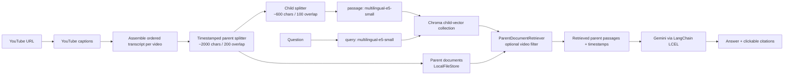

# Multilingual YouTube RAG

Ask grounded questions about one or more captioned YouTube lectures. The project fetches YouTube captions, builds timestamp-aware parent passages, retrieves them with multilingual E5 embeddings, and asks Gemini to answer only from those passages. The Streamlit interface supports independent playback and search selection, English or multilingual answers, and timestamp citation buttons.

## Features

- YouTube videos and playlists with available caption tracks; English is preferred by default, with an explicit caption-language option in the API.
- `intfloat/multilingual-e5-small` embeddings with the required `passage:` and `query:` prefixes.
- LangChain `ParentDocumentRetriever`, Chroma child vectors, and persistent `LocalFileStore` parents.
- Caption-backed parent timestamp ranges and clickable YouTube citations.
- Streamlit lecture selection, active-player switching, response-language selection, chat persistence during reruns, and retrieval debugging.
- FastAPI endpoints for ingestion, chat, caption tracks, video deletion, and health checks.

### Embedding model choice

The application defaults to `intfloat/multilingual-e5-small` to keep embedding latency, memory use, and download size manageable on limited compute resources. `BAAI/bge-m3` is also a suitable higher-capacity multilingual embedding model for this RAG workflow; use it when the deployment has sufficient CPU/GPU memory and you want to evaluate the quality-versus-cost trade-off. To switch, change `EMBEDDING_MODEL_NAME` in `config.py` and create a new Chroma collection and matching parent-store directory rather than mixing embeddings in the existing index.

## Architecture



## Prerequisites

- Windows with Python 3.11 or later.
- Internet access to YouTube for captions and metadata.
- A Google Gemini API key.
- Captioned YouTube videos. Videos with captions disabled cannot be ingested.

## Windows setup

From the repository root:

```powershell
py -3.11 -m venv myenv
.\myenv\Scripts\Activate.ps1
python -m pip install --upgrade pip
python -m pip install -r requirements.txt
$env:GOOGLE_API_KEY = "your-google-gemini-api-key"
```

`GOOGLE_API_KEY` is the only application environment variable. Set it in the shell that launches Streamlit or Uvicorn. For a persistent user-level value, use `setx GOOGLE_API_KEY "your-google-gemini-api-key"`, then open a new terminal.

## Run

Start the Streamlit application:

```powershell
.\myenv\Scripts\python.exe -m streamlit run app.py
```

Start the FastAPI service in another terminal:

```powershell
.\myenv\Scripts\python.exe -m uvicorn api:app --host 127.0.0.1 --port 8000 --reload
```

Open Streamlit at `http://localhost:8501` and API documentation at `http://127.0.0.1:8000/docs`.

## Using the Streamlit app

1. Paste a YouTube URL and select **Add lecture**. A duplicate add reuses its existing index; **Re-ingest** fetches and validates captions, then replaces only that lecture’s vectors and parents.
2. Use a lecture title to change the player. Use its checkbox to include or exclude it from the next search; playback and search scope are independent.
3. Choose the answer language, ask a question, and use the `▶ m:ss` source buttons to seek or switch lectures. A second citation click in the same lecture reloads the embed at the new timestamp.
4. **Clear chat** removes only conversation messages. Indexed lectures and their selected state remain available for the browser session.

If the embedded player is blocked by a browser or network policy, use its **Open this timestamp on YouTube** link.

## API

| Method | Route | Purpose |
| --- | --- | --- |
| `GET` | `/` | Service metadata and route list |
| `GET` | `/health` | Health check |
| `GET` | `/supported-languages` | Response language options |
| `GET` | `/captions/{video_id}` | Available YouTube caption tracks |
| `POST` | `/ingest` | Fetch and index a YouTube URL or playlist |
| `POST` | `/chat` | Ask a grounded question, optionally filtered by `video_ids` |
| `DELETE` | `/videos/{video_id}` | Delete that video’s Chroma children and stored parents |

Example ingestion body:

```json
{"url":"https://youtu.be/VIDEO_ID","language_code":"en","reingest":false}
```

Example chat body:

```json
{"question":"What is LangChain?","response_language":"English","video_ids":["VIDEO_ID"],"k":5}
```

## Local data

- `data/chroma/` — Chroma persistence; the active collection is `video_parents_e5_v2`.
- `data/parent_documents_v2/` — persistent parent passages used by `ParentDocumentRetriever`.
- `data/parent_documents/` — a pre-v2 parent store preserved for old data and not used by the active configuration.
- `data/rag.db` and `data/transcripts/` — legacy local data preserved during cleanup; the current application does not read them.

Do not delete a Chroma directory without deleting its matching parent store, or retrieval may return child-vector IDs whose parent passages no longer exist.

## Tests and validation

Run the deterministic checks:

```powershell
.\myenv\Scripts\python.exe -m unittest tests.test_units -v
.\myenv\Scripts\python.exe -m py_compile app.py api.py retrieval\store.py
```

Current local validation score: **10/10 unit tests passing**. The tests cover URL parsing, caption-language choice, noise cleaning that retains meaningful text such as `(ML)`, transcript assembly, caption-backed parent ranges, E5 prefixes, and citation formatting.

For a live end-to-end retrieval and Gemini generation check:

```powershell
.\myenv\Scripts\python.exe test_retrieval.py
```

## Troubleshooting

- **No captions available:** choose another lecture, or call `/captions/{video_id}` to inspect tracks. Captions are required.
- **YouTube connection error:** verify network/proxy/firewall rules for `www.youtube.com`; retry after connectivity is restored.
- **Gemini authentication or quota error:** set `GOOGLE_API_KEY` in the launching shell and verify the key has Gemini access.
- **Model download/auth warning:** Hugging Face may emit an authentication warning for public model downloads. It is separate from retrieval behavior; cache access or sign in only if your environment requires it.
- **No answer or weak answer:** use the collapsed retrieved-passages expander, select the intended lecture(s), and try a focused question. Increase API `k` only after inspecting retrieved passages.
